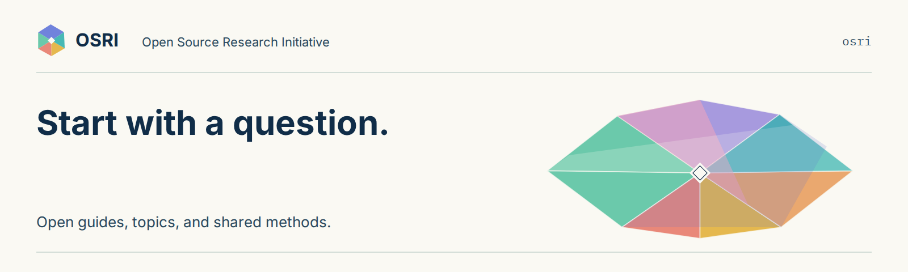

# Open Source Research Initiative

English | [简体中文（待审核）](translations/zh-Hans/README.md) | [Translation help](translations/README.md)

OSRI brings people across fields together to conduct human-driven Agentic-Powered-Research. People choose the questions, check the evidence, and decide what is ready to share.

## Start here

1. Follow the [research guide](START_HERE.md), from a first question to a public output.
2. Bring a question to [Q&A](https://github.com/Open-Source-Research-Initiative/.github/discussions/new?category=q-a) or propose a topic in [Ideas](https://github.com/Open-Source-Research-Initiative/.github/discussions/new?category=ideas).
3. Choose a study from the [research directory](projects/README.md). Open its repository, read the README, and look in **Issues** for tasks. To start a study, use the [research repository template](https://github.com/Open-Source-Research-Initiative/research-repository-template).

A browser is enough to begin. [Choose a contribution](CONTRIBUTING.md): sources, explanations, reviews, writing, data work, code, or models. Your own agent is welcome. No paid agent, plugin bundle, or coding experience is required to start.

## Where the research lives

OSRI is the organization. Each study has its own repository, named after its paper or working title. The repository holds the research files, **Issues** holds tasks, and **Pull requests** holds proposed changes. The shared hub you are reading holds guides, area indexes, and the research directory.

Browse **[Medical XR: from capabilities to sustainable use](https://github.com/Open-Source-Research-Initiative/medical-xr-from-capabilities-to-sustainable-use)**, led by Cole / @ajhcs. Its README explains the question and current state; its [Issues](https://github.com/Open-Source-Research-Initiative/medical-xr-from-capabilities-to-sustainable-use/issues) lists tasks.

## Follow the research

Research can move from a question through evidence, analysis, human review, writing, and publication. The stages can repeat or overlap. People direct the work and authorize publication. Explore the [research journey](identity/prism/research-journey.md).

## Research areas

| Area | Starting scope |
| --- | --- |
| [Healthcare](areas/healthcare.md) | Nonclinical Public Health and Health Systems Research. |
| [Engineering](areas/engineering.md) | Systems Engineering, Engineering Management, Operations Research, and Decision Science. |
| [Informatics](areas/informatics.md) | Bioinformatics, information systems, and Computational Natural Sciences. |
| [Economics](areas/economics.md) | Resources, incentives, public economics, and innovation. |
| [Social and Behavioral Sciences](areas/social-behavioral-sciences.md) | Judgment, collaboration, organizations, and behavior. |
| [Public Policy](areas/public-policy.md) | Policy analysis, evaluation, institutions, and governance. |

The [Simulation Lab guide](simulation-lab/README.md) supports computational experiments across these areas. [Meta-research](meta-research/README.md) is part of how OSRI is administered.

## Use references when needed

- [Choose a topic](topics/README.md): twelve candidate ideas and verified example papers.
- [Find resources](resources/README.md): public data, application programming interfaces (APIs) for finding literature, research software, and administrator access requests.
- [Use tools consistently](tooling/workflows.md): inputs, outputs, and checks for common tasks. The [tool catalog](tooling/README.md) is optional.
- [Read the rules](governance/contribution-standards.md), [find a research repository](projects/README.md), or [record a publication](publications/README.md).
- Follow the guides for [writing](governance/writing-style.md), [translation](governance/translation.md), and [visual identity](governance/visual-identity.md).
- See [contributor activity and recorded research outputs](community/ACTIVITY.md).
- Explore the [Prism landing-page source](site/README.md).

For confidential resource requests, contact [Cole](mailto:cole.lyons@pennmedicine.upenn.edu). The [request guide](governance/resource-requests.md) explains access and delivery.

Original guides and catalogs use CC BY 4.0. Original code and configuration use MIT. Third-party terms remain separate. See [licensing](LICENSE.md).
