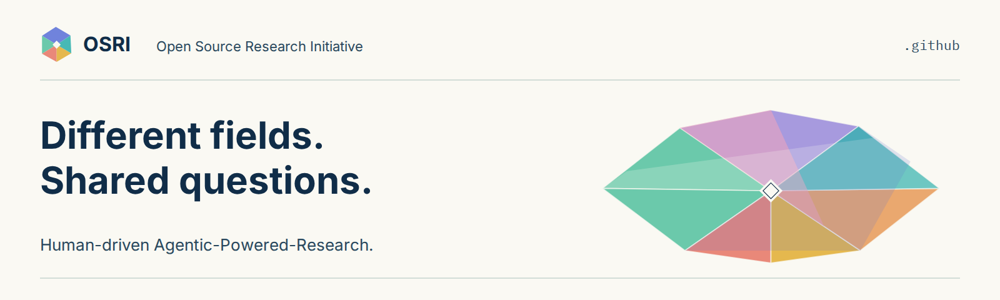

**English** · [简体中文（待审核）](https://github.com/Open-Source-Research-Initiative/.github/blob/main/translations/zh-Hans/profile/README.md) · Français · Español · العربية

*The Chinese profile is a published draft awaiting review. French, Spanish, and Arabic labels are design specimens.*

# Open Source Research Initiative

OSRI is a founder-led initiative seeking collaborators across fields. People define questions, direct Agentic-Powered-Research, and evaluate evidence and conclusions. The research record is tracked in Git.

## Start with a question

Read the [short research guide](https://github.com/Open-Source-Research-Initiative/osri/blob/main/START_HERE.md). Use the [project template](https://github.com/Open-Source-Research-Initiative/project-template) when ready. You can bring your own agent or work manually; no paid tool bundle is required.

## Contribute

- **Bring a question:** propose a research topic in [Ideas](https://github.com/Open-Source-Research-Initiative/.github/discussions/categories/ideas).
- **Build on evidence:** explore [topics](https://github.com/Open-Source-Research-Initiative/osri/tree/main/topics) and [resources](https://github.com/Open-Source-Research-Initiative/osri/tree/main/resources).
- **Improve the shared methods:** read the [contribution standards](https://github.com/Open-Source-Research-Initiative/osri/blob/main/governance/contribution-standards.md) in the OSRI hub.

## How the work moves

Question → evidence → analysis → human review → writing → publication, with revision throughout. People authorize publication. Keep sources, code, decisions, and versions traceable in Git.

## Get help

Ask in [Q&A](https://github.com/Open-Source-Research-Initiative/.github/discussions/categories/q-a) or join the [starter discussion](https://github.com/Open-Source-Research-Initiative/.github/discussions/1).
