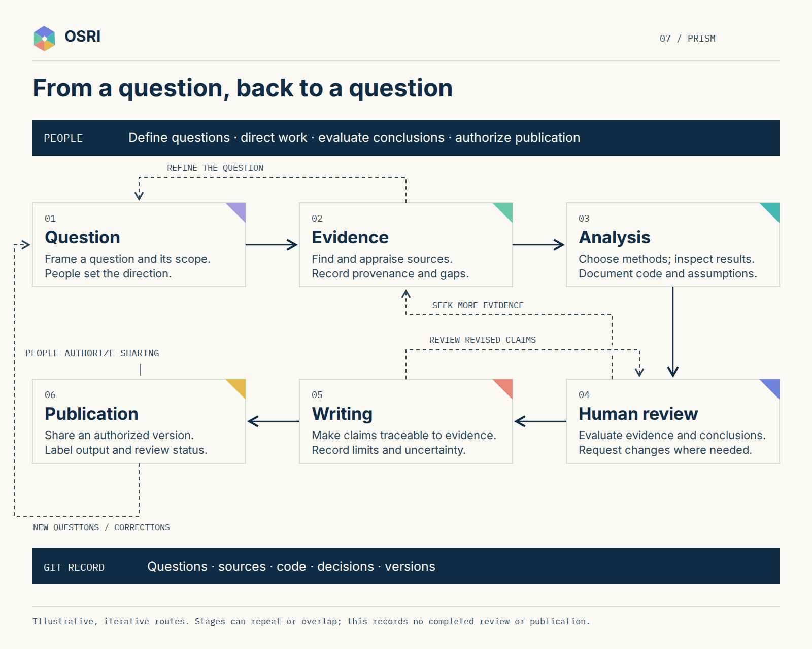

# Research journey

People frame a question and its scope, gather and assess evidence, and choose methods for analysis. People then review the evidence and conclusions, develop the writing, and authorize a version for publication.

These stages can repeat or overlap. Evidence can refine the question; review can send work back to evidence; writing can return to review. A publication can lead to a correction or a new question. Record sources, code, decisions, and versions in Git. The diagram is illustrative and does not claim that any particular review or publication has occurred.

[Editable SVG](sources/07-research-journey.svg) · [Identity kit](README.md) · [Research guide](../../START_HERE.md)
