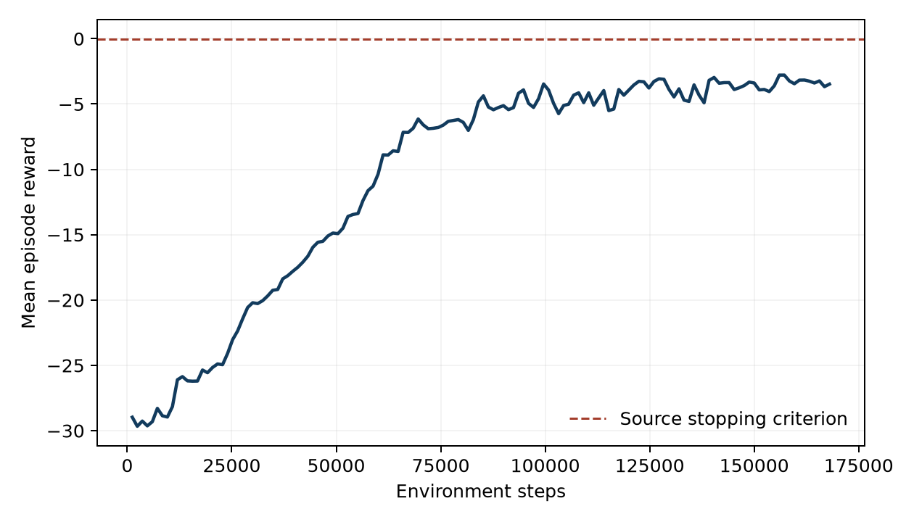
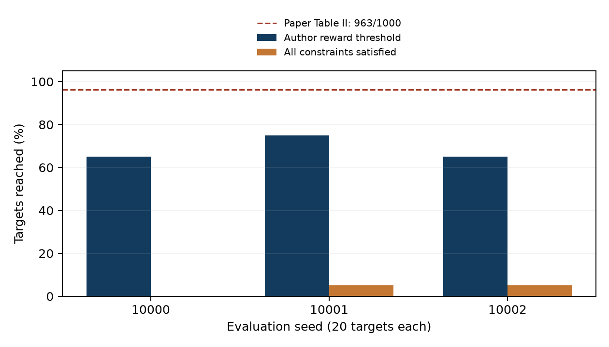

# Evaluate AutoCkt's public ngspice circuit

Use the actual [AutoCkt author repository](https://github.com/ksettaluri6/AutoCkt/tree/a6c8a61d3dffb8b433f19251e135994a5b0f6ee4) to simulate the paper's public 45nm two-stage operational amplifier. [Settaluri et al., DATE 2020](https://doi.org/10.23919/DATE48585.2020.9116200), Section III-B, Figure 6 and Table II, report963/1000 held-out specifications and an average 27 simulations for successful designs. Original policy weights and evaluation seeds were not found in the public repository. The bundled938 reached / 62 unreached arrays are saved target classifications, not a trained agent or a fresh reproduction.

The public source trains a 64×64 policy, while the article states three 50-neuron layers. Its bundled training set contains 350 target vectors, whereas the paper describes 50; the public environment does not partition this file into per-worker subsets. This guide follows the public code and records the mismatch. It covers the public ngspice circuit; Spectre, proprietary technology and post-layout results remain outside this run.

## Retrieve and prepare

Run in an isolated directory, with all environments, caches and outputs on your working-data disk. Place the supplied MIT-licensed harness files beside the destination `AutoCkt` directory. The author repository has no detected reuse license: the harness retrieves it locally and records its identity; the Lab does not distribute that source.

Create an isolated Python 3.6.15 environment. The recorded run used conda-forge for Python and pip 21.3.1, then `requirements-legacy.txt` and the captured `requirements-tested.txt`. The author's TensorFlow 1.10.1/NumPy 1.16.4 pins conflict with TensorFlow's declared NumPy upper bound; the isolated install used pip's legacy resolver to preserve those author pins. Do not apply these old packages to a global environment.

```sh
export AUTOCKT_RUN_ROOT="$PWD"
export TMPDIR="$AUTOCKT_RUN_ROOT/tmp"
export PIP_CACHE_DIR="$AUTOCKT_RUN_ROOT/pip-cache"
mkdir -p "$TMPDIR" "$PIP_CACHE_DIR"
python retrieve_source.py
python -m pip install --use-deprecated=legacy-resolver -r requirements-legacy.txt
python -m pip install opencv-python-headless==3.4.18.65 flatbuffers==1.11 gast==0.3.2
```

Use the environment's Python for each command. Set `AUTOCKT_NGSPICE` to your ngspice executable if it is not on `PATH`; the retained run used ngspice 41, compared with author release 27. Set `AUTOCKT_RAY_TMP` to a short writable path on the working-data disk so the old Ray Unix sockets fit the OS path-length limit. Keep `AUTOCKT_RUN_ROOT`, Ray scratch, native circuit outputs and log directories on that disk.

## Run the circuit and train

```sh
export PYTHONPATH="$AUTOCKT_RUN_ROOT"
export OMP_NUM_THREADS=1 OPENBLAS_NUM_THREADS=1
export TF_NUM_INTRAOP_THREADS=1 TF_NUM_INTEROP_THREADS=1
python circuit_probe.py
export AUTOCKT_SEED=100
export AUTOCKT_TRAIN_ITERATIONS=150 AUTOCKT_TRAIN_SECONDS=900
python train_policy.py
export AUTOCKT_EVAL_SEED=10000 AUTOCKT_EVAL_COUNT=20
python evaluate_policy.py
```

The initial circuit probe runs the author's reset design and a hold action. It verifies native output and repeated measurement, not successful optimization. The harness preserves the native circuit, AC/DC arrays and solver logs. It keeps author observations, actions, measurement functions and reward; it corrects invalid observation-space bounds that otherwise reject the author's own returned values. Scratch paths and output capture also change.

Training follows the public 1200-sample batch,30-step horizon, six-worker CPU configuration. It saves checkpoints and literal learning metrics after every iteration and stops at the author's mean-reward criterion or the declared runtime/iteration limit. A bounded run that has not reached that criterion must remain marked incomplete.

Evaluation generates targets with the author's generator under a separate seed and verifies that target vectors do not overlap the350 bundled training vectors. It keeps the author's success rule and additionally reports strict satisfaction of all four constraints. The author's reward threshold permits a small aggregate normalized deficit, so these counts can differ. Increase the evaluation count to1000 only after the pilot and record the changed command.

## Compare the result

Read `target-plan.json`, the actual training `latest.json`, and the evaluation's `evaluation.json`. Inspect success count, Wilson95% binomial interval, mean successful action count, constraint-by-constraint values and trajectories. Paper proportions are reference observations, not a pass threshold to force by changing seeds. A recreated public-source policy with different architecture, runtime, training budget or seeds is an adaptation; successful native execution alone does not reproduce Table II. Human scientific review is pending.

## Original simulator release check

An isolated source build of the official `ngspice-27` tag (`af7ab797c2b5548a99d9bcb4c7f74556aa4ac67e`) also ran the actual author circuit. Both AC/DC arrays and the four reset-design measurements exactly matched ngspice 41 at the checked settings. This is a bounded version diagnostic, not evidence of equality for every circuit state. The old batch interface returned1 after producing output unless an explicit `quit` was added to the generated control section; `AUTOCKT_ADD_QUIT=1` makes that operational change and leaves the electrical model unchanged.

Use `ngspice27-build.sh` with an existing isolated build-tools prefix if you need to recreate that simulator. No system packages or global environment changes are required by the harness. For the paper-linked training adaptation reported here, the retained training run used ngspice 41; the27 diagnostic does not retroactively change its provenance.

## Retained campaign result

The bounded fresh seed 100 policy completed 140 training iterations / 168000 environment steps in 900.1 seconds. Mean episode reward was -3.4773777264721186. The source stopping criterion was not met; this training remains incomplete.

Final independent 20-target tests were:

| Evaluation seed | Author success | Strict success | Wilson95% interval for author success |
| --- | --- | --- | --- |
| 10000 | 13/20 | 0/20 | [0.4328542766852419, 0.8188081758989145] |
| 10001 | 15/20 | 1/20 | [0.5312991223812622, 0.8881382985923318] |
| 10002 | 13/20 | 1/20 | [0.4328542766852419, 0.8188081758989145] |

The article reports 963/1000 for a different historical policy/training setup. These adapted-run counts are descriptive comparisons and do not establish historical equivalence. The earlier checkpoint 46 pilot and interrupted run remain separate evidence. No full 1000-target test was run because this bounded policy did not complete training.





One source-reward success produced phase margin 58.4769° against a 60° minimum. The strict metric rejects it. The reported Wilson intervals describe target sampling for this single newly trained policy; they do not quantify uncertainty across independently trained policies or establish equivalence to the article.

## Download the recorded files

- [retrieve_source.py](files/ngspice/retrieve_source.py) — portable_harness_or_evidence.
- [author_runtime.py](files/ngspice/author_runtime.py) — portable_harness_or_evidence.
- [circuit_probe.py](files/ngspice/circuit_probe.py) — portable_harness_or_evidence.
- [train_policy.py](files/ngspice/train_policy.py) — portable_harness_or_evidence.
- [evaluate_policy.py](files/ngspice/evaluate_policy.py) — portable_harness_or_evidence.
- [requirements-legacy.txt](files/ngspice/requirements-legacy.txt) — portable_harness_or_evidence.
- [requirements-tested.txt](files/ngspice/requirements-tested.txt) — portable_harness_or_evidence.
- [conda-explicit-clean.txt](files/ngspice/conda-explicit-clean.txt) — portable_harness_or_evidence.
- [target-plan.json](files/ngspice/target-plan.json) — portable_harness_or_evidence.
- [capacitance-check.json](files/ngspice/diagnostics/capacitance-check.json) — portable_harness_or_evidence.
- [ngspice-version-comparison.json](files/ngspice/diagnostics/ngspice-version-comparison.json) — portable_harness_or_evidence.
- [source-hashes.json](files/ngspice/source-hashes.json) — portable_harness_or_evidence.
- [reset-dc.csv](files/ngspice/public_outputs/reset-dc.csv) — numerical_output.
- [seed10001-evaluation.json](files/ngspice/public_outputs/seed10001-evaluation.json) — numerical_output.
- [reset-ac.csv](files/ngspice/public_outputs/reset-ac.csv) — numerical_output.
- [seed10002-evaluation.json](files/ngspice/public_outputs/seed10002-evaluation.json) — numerical_output.
- [seed10002-episodes.csv](files/ngspice/public_outputs/seed10002-episodes.csv) — numerical_output.
- [learning-curve.csv](files/ngspice/public_outputs/learning-curve.csv) — numerical_output.
- [seed10001-episodes.csv](files/ngspice/public_outputs/seed10001-episodes.csv) — numerical_output.
- [summary.json](files/ngspice/public_outputs/summary.json) — numerical_output.
- [seed10000-evaluation.json](files/ngspice/public_outputs/seed10000-evaluation.json) — numerical_output.
- [seed10000-episodes.csv](files/ngspice/public_outputs/seed10000-episodes.csv) — numerical_output.
- [training-curve.png](files/ngspice/public_outputs/training-curve.png) — numerical_output.
- [heldout-success.png](files/ngspice/public_outputs/heldout-success.png) — numerical_output.
- [plot_outputs.py](files/ngspice/plot_outputs.py) — portable_harness_or_evidence.
- [plotting-requirements.txt](files/ngspice/plotting-requirements.txt) — portable_harness_or_evidence.
- [ngspice-version-file-hashes.json](files/ngspice/diagnostics/ngspice-version-file-hashes.json) — portable_harness_or_evidence.
- [guide.md](files/ngspice/guide.md) — portable driver or environment/source record.
- [ngspice27-build.sh](files/ngspice/ngspice27-build.sh) — portable driver or environment/source record.

[Complete run record](records/ngspice.json) · [All candidate attempts](README.md). Human scientific review is pending.
