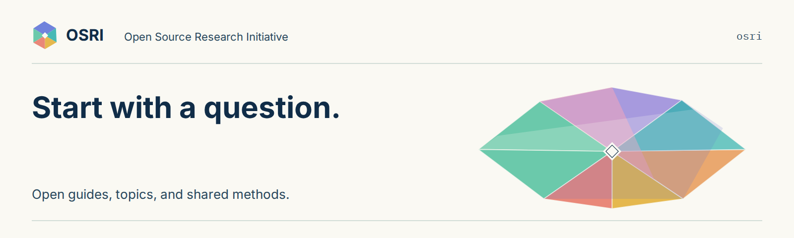

# Open Source Research Initiative

> **待审核译稿（draft）** · 译者：Codex · 人工审核：待定 · [英文参考原文](https://github.com/Open-Source-Research-Initiative/osri/blob/30e7f170c95442a08da107934cdd5be64b1098ec/README.md)

[English](../../README.md) | [翻译协作（英文）](../README.md)

OSRI 汇集不同领域的参与者，开展由人主导的 Agentic-Powered-Research。人来选择问题、核查证据，并决定哪些成果可以公开。

## 从这里开始

1. 按照[研究入门指南](START_HERE.md)，从最初的问题逐步形成可以公开的研究成果。
2. 在[问答区（Q&A）](https://github.com/Open-Source-Research-Initiative/.github/discussions/new?category=q-a)提问，或在[想法区（Ideas）](https://github.com/Open-Source-Research-Initiative/.github/discussions/new?category=ideas)提出研究主题。
3. 项目准备就绪后，使用[项目模板（中文待审核译稿）](https://github.com/Open-Source-Research-Initiative/project-template/blob/main/translations/zh-Hans/README.md)。每个研究项目使用独立的仓库。

有浏览器就可以开始。[选择一项贡献](CONTRIBUTING.md)：资料、解释、评审、写作、数据处理、代码或模型。欢迎使用自己的智能体。入门不要求付费智能体、插件套装或编程经验。

[社区行为准则](CODE_OF_CONDUCT.md)

## 了解研究过程

研究可以从问题出发，经过证据、分析、人工评审、写作与发表。各阶段可以重复或重叠。由人指导工作并授权发表。查看[研究流程（英文）](../../identity/prism/research-journey.md)。

## 研究领域

| 领域 | 初始范围 |
| --- | --- |
| [卫生健康（英文）](../../areas/healthcare.md) | 公共卫生与卫生系统研究，初期聚焦非临床研究。 |
| [工程（英文）](../../areas/engineering.md) | 系统工程、工程管理、运筹学与决策科学。 |
| [信息学（英文）](../../areas/informatics.md) | 生物信息学、信息系统与计算自然科学。 |
| [经济学（英文）](../../areas/economics.md) | 资源、激励、公共经济学，以及研究与创新。 |
| [社会与行为科学（英文）](../../areas/social-behavioral-sciences.md) | 判断、协作、组织与行为。 |
| [公共政策（英文）](../../areas/public-policy.md) | 政策分析、评估、制度与治理。 |

[仿真实验室指南（英文）](../../simulation-lab/README.md)为这些领域的计算实验提供指导。[元研究（英文）](../../meta-research/README.md)，即对研究实践本身的研究，是 OSRI 管理工作的一部分。

## 按需查阅

- [选择主题（英文）](../../topics/README.md)：十二个候选方向及已核实的示例论文。
- [寻找资源（英文）](../../resources/README.md)：公开数据、用于文献检索的应用程序编程接口（API）、研究软件，以及向管理员申请资源的方式。
- [一致地使用工具（英文）](../../tooling/workflows.md)：常见任务的输入、输出与检查要求。[工具目录（英文）](../../tooling/README.md)供按需参考。
- 阅读[贡献规范](governance/contribution-standards.md)、[查找项目（英文）](../../projects/README.md)，或[登记发表成果](publications/README.md)。
- 遵循[写作](governance/writing-style.md)、[翻译](governance/translation.md)与[视觉识别](governance/visual-identity.md)指南。
- 查看[贡献与研究成果记录（英文）](../../community/ACTIVITY.md)。
- 查看 [Prism 介绍页源文件（英文）](../../site/README.md)。

涉及保密信息的资源请求，请联系 [Cole](mailto:cole.lyons@pennmedicine.upenn.edu)。[申请指南](governance/resource-requests.md)说明了访问与交付方式。

原创指南与目录采用 CC BY 4.0；原创代码与配置采用 MIT。第三方材料保留各自的条款。详见[许可说明（英文）](../../LICENSE.md)。
